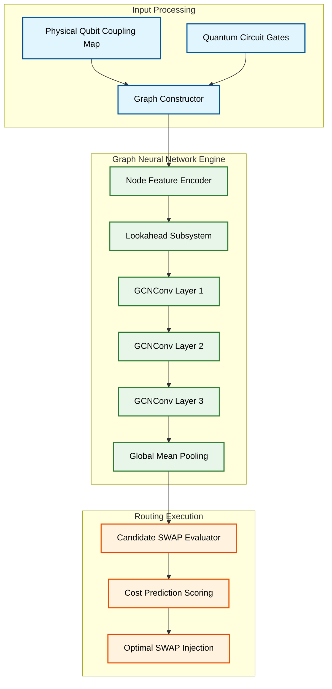

# Predictive Qubit Mapping: Hardware-Agnostic Quantum Routing via Topological GNNs


This repository contains the code for a quantum circuit routing compiler we built. It uses a Graph Neural Network (GNN) to figure out the best places to insert SWAP gates so that quantum circuits can actually run on physical hardware. 

The main problem with Noisy Intermediate-Scale Quantum (NISQ) devices is that adding too many SWAP gates causes decoherence. While traditional compilers usually rely on fixed search heuristics or machine learning models that just memorize one specific chip layout, we wanted to build something completely hardware-agnostic. Our GNN actually learns the topological rules of how qubits interact, meaning it can dynamically route circuits over any physical coupling map.

## Key Results
To prove that this works, we ran a massive stress test generating 1,000 highly entangled random quantum circuits (each packed with 21 to 40 logical gates) and routed them onto a 5-qubit array. 

*   **Greedy Baseline Compiler:** 30,104 total SWAPs injected (30.10 avg)
*   **Our GNN Compiler:** 23,431 total SWAPs injected (23.43 avg)
*   **Compile Latency:** 35.5 ms per circuit

Our model achieved a **22.17% reduction** in SWAP overhead compared to the standard baseline (winning or matching on **90.1%** of evaluated circuits). This directly translates to shorter physical circuits and fewer decoherence errors.

### Zero-Shot Cross-Topology Transfer (30–40 Gate Deep Circuits)
Trained exclusively on a 5-qubit linear array, the GNN transfers **zero-shot (without retraining)** to unseen branching, cyclic, and 7-qubit architectures:

| Topology / Architecture | Qubits | Coupling Structure | Baseline Avg SWAPs | GNN Avg SWAPs | SWAP Reduction |
| :--- | :---: | :--- | :---: | :---: | :---: |
| **Linear Path (Trained)** | 5 | Linear Array | 34.82 | **25.38** | **+27.1%** |
| **T-Junction (Zero-Shot)** | 5 | Branching Star/Fork | 27.66 | **23.14** | **+16.3%** |
| **Cyclic Ring (Zero-Shot)** | 5 | Closed Loop | 17.32 | **13.12** | **+24.2%** |
| **IBM Falcon Subgraph (Zero-Shot)** | 7 | Heterogeneous 7Q Tree | 49.06 | **41.40** | **+15.6%** |

> **Research Benchmarks & Multi-Paradigm Comparison:** For the full 4-paradigm comparative benchmark (Greedy vs. Tabular Random Forest vs. Deep RL PPO vs. GNN) and experimental artifacts from our study, see the [`ieee-paper-benchmarks`](https://github.com/Jerielphilly/Predictive-Qubit-Mapping/tree/ieee-paper-benchmarks) branch.

<p align="center">
  
  
</p>

---

## Installation & Setup

1. **Clone the repository:**
   ```bash
   git clone https://github.com/Jerielphilly/Predictive-Qubit-Mapping.git
   cd Predictive-Qubit-Mapping
   ```

2. **Set up a virtual environment (Recommended):**
   *Windows:*
   ```powershell
   python -m venv venv
   .\venv\Scripts\activate
   ```
   *macOS/Linux:*
   ```bash
   python3 -m venv venv
   source venv/bin/activate
   ```

3. **Install the required packages:**
   ```bash
   pip install -r requirements.txt
   ```
   *(Note: You'll want to make sure PyTorch and PyTorch Geometric are correctly configured for your specific OS and CUDA version).*

---

## Usage

### 1. Interactive Streamlit Dashboard (Live Demo)
We built a web dashboard to make it easy to visualize how the routing works in real-time. It dynamically generates random quantum circuits and runs a side-by-side compilation race between the Baseline method and our GNN.

```bash
streamlit run app.py
```
Just open `http://localhost:8501` in your browser. From there you can read up on the methodology, run the 1000-circuit benchmark yourself, and watch the live routing demo physically draw the compiled Qiskit circuits on the screen.

### 2. Run the Benchmarks Locally
If you just want to run the math headless and generate the performance graphs:

```bash
# Run the 1,000-circuit benchmark (saves to results/benchmark_all_results.csv)
python compare.py

# Run the zero-shot multi-topology transfer benchmark (5Q Line, T-Junction, Ring, 7Q IBM Falcon)
python benchmark_multitopology.py

# Generate the visual graphs (saves PNGs to the results folder)
python generate_graphs.py
```

### 3. Retrain the GNN Model
If you want to tweak the node features or train the model from scratch:

```bash
# Generate 5,000 random circuits and encode them into PyTorch Geometric graphs
python gnn_dataset.py

# Train the 3-layer GCNConv model (Saves the weights to models/gnn_routing_model.pt)
python train_gnn.py
```

---

## How it Works (System Architecture)



The compiler is broken down into three main steps:
1. **Graph Construction:** We take the physical quantum chip layout and the upcoming logical gates and encode them together into a PyTorch Geometric graph.
2. **Feature Encoding & Lookahead:** Every qubit (node) gets a 9-dimensional feature vector. This tracks things like shortest-path distances and a forward-looking "gate-pressure" score to see how heavily a qubit will be used in the future.
3. **Routing Inference:** We pass this graph through a 3-layer GCNConv network. After global mean pooling, a regression head predicts exactly how much routing cost a potential SWAP will incur in the future. The system then dynamically picks the SWAP with the lowest predicted cost and moves on to the next gate.

---

## Repository Structure

```text
├── data/                       # Datasets and generated graph data
├── models/
│   └── gnn_routing_model.pt    # Pre-trained GNN model weights
├── results/                    # CSV outputs and generated PNG graphs
├── app.py                      # Streamlit dashboard application
├── architecture_diagram.md     # Mermaid.js system block diagram
├── benchmark_multitopology.py  # Zero-shot cross-topology benchmark (5Q & 7Q)
├── compare.py                  # 1,000-circuit benchmark script (GNN vs Greedy)
├── generate_graphs.py          # Data visualization script
├── gnn_dataset.py              # PyTorch Geometric dataset generator
├── gnn_router.py               # Core GNN routing inference logic
├── router.py                   # Baseline shortest-path heuristic router
├── train_gnn.py                # Model training script
└── requirements.txt            # Python dependencies
```
