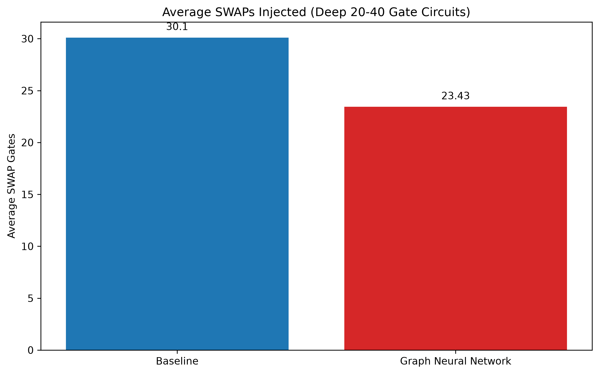
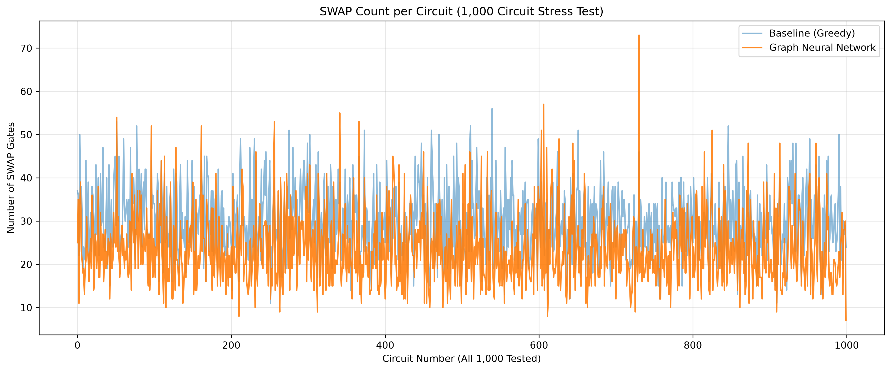

# Predictive Qubit Mapping: Hardware-Agnostic Quantum Routing via Topological GNNs


This repository contains the official implementation of **Predictive Qubit Mapping**, a novel quantum circuit compilation framework. It utilizes a **Graph Neural Network (GNN)** to predict and inject optimal SWAP gates, successfully minimizing decoherence overhead in Noisy Intermediate-Scale Quantum (NISQ) devices.

Unlike traditional heuristic algorithms or tabular machine learning methods tied to fixed hardware arrays, this model explicitly learns topological message-passing rules over the physical coupling map, rendering it completely **hardware-agnostic**.

## 🚀 Key Results
In a massive 1,000-circuit stress test (20-40 deeply entangled gates per circuit) mapped onto a 5-qubit array:
*   **Greedy Baseline Compiler:** 30,104 SWAPs injected
*   **Proposed GNN Compiler:** 23,431 SWAPs injected
*   **Net Result:** A **~22.1% reduction** in SWAP overhead, significantly reducing final circuit depth.

<p align="center">
  
  
</p>

---

## 🛠️ Installation & Setup

1. **Clone the repository:**
   ```bash
   git clone https://github.com/Jerielphilly/Predictive-Qubit-Mapping.git
   cd Predictive-Qubit-Mapping
   ```

2. **Create and activate a virtual environment (Recommended):**
   *Windows:*
   ```powershell
   python -m venv venv
   .\venv\Scripts\activate
   ```
   *macOS/Linux:*
   ```bash
   python3 -m venv venv
   source venv/bin/activate
   ```

3. **Install dependencies:**
   ```bash
   pip install -r requirements.txt
   ```
   *(Note: Ensure you have PyTorch and PyTorch Geometric properly configured for your specific OS/CUDA version).*

---

## 💻 Usage

### 1. Interactive Streamlit Dashboard (Live Demo)
We provide a rich, interactive web interface to visualize the routing process in real-time. The dashboard dynamically generates random quantum circuits and runs a side-by-side execution race between the Baseline Compiler and our GNN.

```bash
streamlit run app.py
```
*   Navigate to `http://localhost:8501` in your browser.
*   Explore the **Methodology**, run the **1000-Circuit Benchmark**, and watch the **Live Routing Demo** draw compiled circuits.

### 2. Run the Benchmark Locally
To reproduce our 1,000-circuit stress test and generate the performance graphs:

```bash
# 1. Run the benchmark (saves to results/benchmark_all_results.csv)
python compare.py

# 2. Generate the visual graphs (saves PNGs to results/)
python generate_graphs.py
```

### 3. Retrain the GNN Model
If you wish to experiment with different topological features or train the GNN from scratch:

```bash
# 1. Generate 5,000 random circuits and encode them into PyTorch Geometric graphs
python gnn_dataset.py

# 2. Train the 3-layer GCNConv model (Saves to models/gnn_routing_model.pt)
python train_gnn.py
```

---

## 🧠 System Architecture

The compilation framework is divided into three primary modules:
1. **Per-Candidate Graph Construction:** The physical quantum chip and impending logical gates are structurally encoded into a PyTorch Geometric graph.
2. **Feature Encoding & Lookahead:** Each node (qubit) is embedded with a 9-dimensional feature vector, integrating shortest-path distances and a forward-looking "gate-pressure" metric.
3. **Topology-Independent Routing Inference:** A 3-layer GCNConv model processes the graph via message passing. Global mean pooling feeds into a regression head to predict the routing cost of potential SWAPs, dynamically selecting the absolute lowest-cost move.

---

## 📁 Repository Structure

```text
├── data/                       # Datasets and generated graph data
├── models/
│   └── gnn_routing_model.pt    # Pre-trained GNN model weights
├── results/                    # CSV outputs and generated PNG graphs
├── app.py                      # Streamlit dashboard application
├── architecture_diagram.md     # Mermaid.js system block diagram
├── compare.py                  # Benchmark script (GNN vs Greedy)
├── generate_graphs.py          # Data visualization script
├── gnn_dataset.py              # PyTorch Geometric dataset generator
├── gnn_router.py               # Core GNN routing inference logic
├── router.py                   # Baseline shortest-path heuristic router
├── train_gnn.py                # Model training script
└── requirements.txt            # Python dependencies
```
